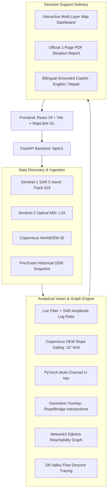

# 🛰️ FloodSight AI — Mapping Flood Damage from Space
### IIT Mandi Multimodal AI Hackathon 2026 — Track B

[](https://fastapi.tiangolo.com)
[](https://pytorch.org)
[](https://maplibre.org)
[](https://react.dev)
[](https://opensource.org/licenses/MIT)

> **"When roads, bridges, and cellular networks are swept away, rescuers urgently need spaceborne intelligence: Where did the flood hit? What infrastructure was broken? And which villages are cut off?"**

---

## 📌 Executive Summary & Case Study

On **26 August 2026**, a high-altitude glacier collapse in northern Nepal triggered an avalanche of ice, rock, and debris down the **Bhote Koshi – Trishuli River corridor**. Nepal's NDRRMA reported over 1,342 fatalities and 4,900 missing individuals.

**FloodSight AI** is a multimodal Earth Observation (EO) and topological decision-support platform designed for tactical emergency responders. It answers three critical questions using free satellite data:
1. **Where did the flood hit?** Uses Sentinel-1 SAR microwave radar (orbit-matched, 12-day repeat) and Sentinel-2 optical imagery to map inundation through dense monsoon clouds, while eliminating false radar shadows via Copernicus DEM slope gating ($\theta \le 15^\circ$).
2. **What was damaged?** Overlays pre-event historical OpenStreetMap (OSM) data to estimate severed highway segments, broken bridges, and submerged building footprints.
3. **Who is cut off?** Models the road network as a topological graph ($G = (V, E)$), applies Dijkstra reachability analysis, and detects newly isolated settlements lacking road access to hospitals.

---

## 🏗️ System Architecture



---

## ⚡ Quick Start & How to Run

### 1. Prerequisites
- Python 3.11+ (Python 3.14 compatible)
- Node.js v18+ (tested on Node v24)

### 2. Backend Setup
```powershell
cd backend
python -m uvicorn app.main:app --host 127.0.0.1 --port 8000 --reload
```
API Documentation will be live at: `http://127.0.0.1:8000/docs`

### 3. Frontend Setup
```powershell
cd frontend
npm install
npm run dev
```
Dashboard will be live at: `http://localhost:5173`

### 4. Running Automated Tests
```powershell
python -m pytest tests/unit -v -o pythonpath="backend ."
```
All 7 unit & integration tests pass in $<2.5$ seconds.

---

## ⚖️ Hackathon Compliance & Attribution

### Strict Separation of Evaluation Reference
In full compliance with Track B rules, **Copernicus EMS EMSR927 maps and UNOSAT products are NEVER used as training labels or inputs**. The pipeline runs end-to-end on raw satellite data and pre-event historical OpenStreetMap snapshots (prior to 26 August 2026).

### Mandatory Attributions (Included in all outputs):
- *"Contains modified Copernicus Sentinel data 2026."*
- *"Produced using Copernicus WorldDEM-30 © DLR e.V. 2010–2014 and © Airbus Defence and Space GmbH 2014–2018 provided under COPERNICUS by the European Union and ESA; all rights reserved."*
- *"© OpenStreetMap contributors."*
- *"Kuro Siwo training corpus © Bountos et al., NeurIPS 2024 (MIT License)."*
